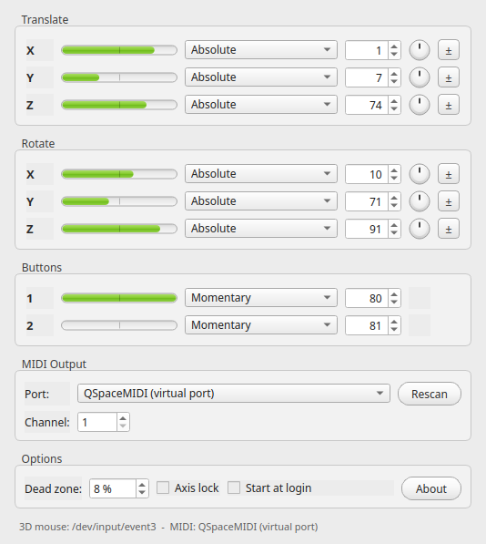

# QSpaceMIDI

Maps a [3Dconnexion SpaceNavigator](https://3dconnexion.com/) 3D mouse to MIDI
control change messages, so its six degrees of freedom become six MIDI
controllers for [Renoise](https://www.renoise.com/) or any other MIDI host.

Qt 6, C++23, CMake. Runs on Linux, macOS and Windows, and **needs no 3DxWare
driver**: the device is read directly through evdev (Linux), IOKit HID (macOS)
and raw HID (Windows).



The window follows Stefan Hoffmann's Mac OS X application
[MIDI Navigator](http://keindesign.de/stefan/Web/Sites/iWeb/Site/MIDI%20Navigator.html):
one row per degree of freedom, with a level meter, the CC mode, the CC number
and a sensitivity knob.

## Features

- All six axes plus both hardware buttons, each on its own configurable CC.
- Absolute and three relative CC encodings, selectable per axis.
- Per-axis sensitivity knob, and a global dead zone that filters the resting
  jitter of the cap.
- **Axis lock**: only the axis that is deflected the most is transmitted, so
  parameters stop bleeding into each other while you MIDI-map in the host.
- Publishes a virtual `QSpaceMIDI` MIDI port on Linux and macOS; on Windows
  it connects to an existing port such as a [loopMIDI](https://www.tobias-erichsen.de/software/loopmidi.html)
  port.
- System tray icon: close the window and the mapping keeps running.
- **Single instance**: launching QSpaceMIDI again just brings the running
  window to the front instead of starting a second copy.
- **Start at login**: one checkbox writes the platform's autostart entry, so
  the mapping is live right after you log in.
- Translated into Danish, English, Finnish, French, German, Italian, Japanese,
  Russian and Simplified Chinese; the UI follows the system language.
- Everything is stored with `QSettings` and restored on the next start.

## Default mapping

| Axis     | Direction                | Default CC |
| -------- | ------------------------ | ---------- |
| X        | Left / right             | CC 1       |
| Y        | Forward / backward       | CC 7       |
| Z        | Up / down                | CC 74      |
| RX       | Tilt left / right        | CC 10      |
| RY       | Tilt forward / backward  | CC 71      |
| RZ       | Rotate                   | CC 91      |
| Button 1 | Press                    | CC 80      |
| Button 2 | Press                    | CC 81      |

Every CC number, mode and sensitivity can be changed in the window. The **±**
button at the end of a row inverts that axis, and the row's context menu can
mute it or reset its sensitivity.

## CC modes

| Mode                     | Encoding                                              |
| ------------------------ | ----------------------------------------------------- |
| Absolute                 | The deflection itself: 0..127, centre 64.             |
| Relative (Bin Offset)    | 64 means no change, 65..127 counts up, 63..1 down.    |
| Relative (2's Comp)      | 1..63 counts up, 127..65 counts down.                 |
| Relative (Signed Bit)    | 65..127 counts up, 1..63 counts down.                 |

Absolute is the mode most hosts, Renoise included, expect when learning a
parameter. The relative modes keep sending increments for as long as the cap
is deflected, which suits endless encoders and relative-mode host mappings.

## Download

Every tagged release carries binaries for all three platforms:

- <https://github.com/koppi/qspacemidi/releases/latest>

| Platform | Artifact |
| -------- | -------- |
| Debian 12 / 13 / 14, Ubuntu 24.04 / 26.04 (amd64 and arm64) | `qspacemidi_<version>~<codename>_<arch>.deb` |
| Any other Linux | `QSpaceMIDI-x86_64.AppImage` |
| macOS | `QSpaceMIDI-macOS.dmg` |
| Windows | `QSpaceMIDI-windows-x64.zip` |

Older releases such as Ubuntu 22.04 and Debian 11 are not packaged: they ship
CMake 3.22 or no Qt 6 at all. The AppImage runs there.

## Building from source

Requirements: CMake 3.24 or newer, a C++23 compiler and Qt 6.4 or newer.
[libremidi](https://github.com/atsushieno/libremidi) is downloaded
automatically by CMake.

```sh
git clone https://github.com/koppi/qspacemidi.git
cd qspacemidi
cmake -S . -B build -DCMAKE_BUILD_TYPE=Release
cmake --build build --parallel
./build/qspacemidi
```

### Linux

```sh
sudo apt install build-essential cmake qt6-base-dev libgl1-mesa-dev \
                 libasound2-dev libudev-dev
```

The 3D mouse lives at `/dev/input/event*`, which is root-only on most
distributions. Install the bundled udev rules once so that your user can read
it:

```sh
sudo cp packaging/99-spacenavigator.rules /etc/udev/rules.d/
sudo udevadm control --reload-rules && sudo udevadm trigger
```

Then unplug and replug the device.

A Debian package can be built from the `debian/` directory:

```sh
sudo apt install devscripts equivs
sudo mk-build-deps -i -r -t "apt-get -y --no-install-recommends" debian/control
dpkg-buildpackage -us -uc -b
```

The `.deb` lands in the parent directory. The build downloads libremidi, so it
needs network access; pass
`-DFETCHCONTENT_SOURCE_DIR_LIBREMIDI=/path/to/libremidi` to build offline.
CPack works too: `cd build && cpack -G "DEB;TGZ"`.

Ubuntu 22.04 and older ship Qt 6.2, which is too old; use the AppImage from the
releases page there.

### macOS

Install Qt 6 (for example with `brew install qt`), then build as above. The
result is `build/qspacemidi.app`; run `macdeployqt build/qspacemidi.app` to get
a self-contained bundle.

### Windows

Install Qt 6 for MSVC and build with the Visual Studio generator. Windows has
no virtual MIDI ports, so install [loopMIDI](https://www.tobias-erichsen.de/software/loopmidi.html),
create a port there and select it in the **Port** box.

## Using it with Renoise

1. Start QSpaceMIDI and move the cap - the meters follow the device.
2. In Renoise, open **Preferences → MIDI** and enable **QSpaceMIDI** as an
   input device.
3. Right click the parameter you want to control and choose **MIDI Map**.
4. Tick **Axis lock** in QSpaceMIDI and push the axis you want to assign. Only
   that axis is transmitted, so the mapping lands on the axis you intended.
5. Untick **Axis lock** when you are done mapping to play all axes at once.
6. If a parameter moves the wrong way, press the **±** button on that row.

Tip: use the sensitivity knob to trade range against precision, and raise the
dead zone if a parameter drifts while the cap is at rest.

The meters follow the cap itself, at whatever rate the device reports: they
ignore the dead zone and the axis lock, so even a movement too small to send a
CC is visible. What reaches the host is what the rows below the meters say.

## Command line

```
qspacemidi [options]

  -m, --minimized       Start hidden in the system tray.
      --screenshot FILE Render the window to FILE and exit.
  -h, --help            Show the help.
  -v, --version         Show the version.
```

`QSPACEMIDI_LANG=<code>` overrides the interface language for one run.

## Single instance

Only one QSpaceMIDI runs per user. Starting it again - from a launcher, the
command line or by clicking the icon while it sits in the tray - hands the
running instance a request to show its window and then exits. A launch with
`--minimized` defers in the same way but leaves the window as it was, so the
autostart entry never disturbs a window you opened yourself.

The instances find each other through a `QLocalServer` whose name is derived
from your home directory, so two users, or two desktop sessions with separate
homes, each keep their own instance. A socket left behind by a crash is
cleared automatically on the next start.

## Autostart

The **Start at login** checkbox writes the platform's own autostart entry,
which launches QSpaceMIDI with `--minimized` so it goes straight to the tray:

- Linux: `~/.config/autostart/qspacemidi.desktop`
- macOS: `~/Library/LaunchAgents/org.koppi.qspacemidi.plist`
- Windows: `HKEY_CURRENT_USER\Software\Microsoft\Windows\CurrentVersion\Run`

Unticking the box removes the entry again.

## Tray icon

KDE draws a status notifier icon from the icon theme when it is given the
icon's *name*, which is what lets it recolour a monochrome icon to match the
panel - light text on a dark panel and the other way round. QSpaceMIDI
therefore installs a monochrome icon as
`share/icons/hicolor/scalable/status/qspacemidi-symbolic.svg`, drawn to the
Breeze convention, and hands the tray its name.

`tray/iconStyle` in the configuration chooses between them:

| Value | Tray icon |
| ----- | --------- |
| `auto` (default) | monochrome wherever the icon theme provides it, colourful otherwise |
| `monochrome` | always the monochrome icon |
| `colour` | always the colourful icon |

`auto` falls back to the colourful icon when the monochrome one is not
installed system wide - running straight from a build directory, or from the
AppImage, whose files the panel process cannot see. A colourful icon travels
to the panel as pixels and stays visible on any panel; a monochrome one that
the desktop cannot look up would leave an empty space.

## Languages

The interface ships in Danish, English, Finnish, French, German, Italian,
Japanese, Russian and Simplified Chinese, and follows the system language.
Set `QSPACEMIDI_LANG` to try another one:

```sh
QSPACEMIDI_LANG=ja qspacemidi
```

The translations live in [`translations/`](translations) as Qt Linguist `.ts`
files and are compiled into the binary at build time. After changing a string
in the sources, refresh them with `cmake --build build --target
update_translations` and edit the new entries with Qt Linguist.

## Configuration

Settings are written through `QSettings`, which means:

- Linux: `~/.config/koppi/QSpaceMIDI.conf`
- macOS: `~/Library/Preferences/io.github.koppi.QSpaceMIDI.plist`
- Windows: `HKEY_CURRENT_USER\Software\koppi\QSpaceMIDI`

Delete that entry to return to the defaults.

Two keys have no control in the window:

| Key | Default | Meaning |
| --- | ------- | ------- |
| `tray/iconStyle` | `auto` | `auto`, `monochrome` or `colour`, see [Tray icon](#tray-icon) |
| `input/updateRate` | 60 | CC updates per second, 10..200 |
| `input/idleTimeout` | 150 | Milliseconds of silence after which the cap counts as released, 40..2000; 0 disables the watchdog |

`idleTimeout` only applies to devices that report **relative** movement
(Linux `EV_REL`). Those go quiet once the cap stops moving and never announce
that it sprang back, so silence is the only way to tell; after `idleTimeout`
of it the axes are treated as centred. Set 0 to switch that off.

Devices that report **absolute** positions - Windows and macOS HID, and Linux
`EV_ABS`, which covers every current 3Dconnexion model - always send an event
carrying the centre position, so the watchdog stays off for them. It has to:
the kernel drops repeated identical values, so a cap held at a steady
deflection produces no events at all, and a watchdog would wrongly re-centre
it.

## Layout of the source

| Path                              | Contents                                        |
| --------------------------------- | ----------------------------------------------- |
| `src/mainwindow.*`                | Window, mapping loop and tray icon              |
| `src/mapping.*`                   | Axis model, dead zone and the CC encodings      |
| `src/midiengine.*`                | libremidi output port handling                  |
| `src/settings.*`                  | `QSettings` persistence                         |
| `src/widgets/`                    | Level meter, sensitivity knob, axis row         |
| `src/thirdparty/spacenavigator/`  | Event-driven 3D mouse driver for the three OSes |
| `src/autostart.*`                 | The per-platform autostart entry                |
| `translations/`                   | Qt Linguist `.ts` files, one per language       |
| `packaging/`                      | Desktop entry, AppStream data and udev rules    |
| `debian/`                         | Debian packaging                                |
| `docs/`                           | The GitHub Pages site                           |

## Licence

QSpaceMIDI is free software, licensed under the
[GNU Lesser General Public License](COPYING.LESSER), version 2.1 or (at your
option) any later version. See [COPYING](COPYING) for the GPL text the LGPL
refers to.

Copyright © 2013-2026 Jakob Flierl <jakob.flierl@gmail.com>

## Credits

- Stefan Hoffmann for the original *MIDI Navigator*, whose window this one
  reproduces.
- [libremidi](https://github.com/atsushieno/libremidi) by Jean-Michaël Celerier
  for the MIDI back-ends.
